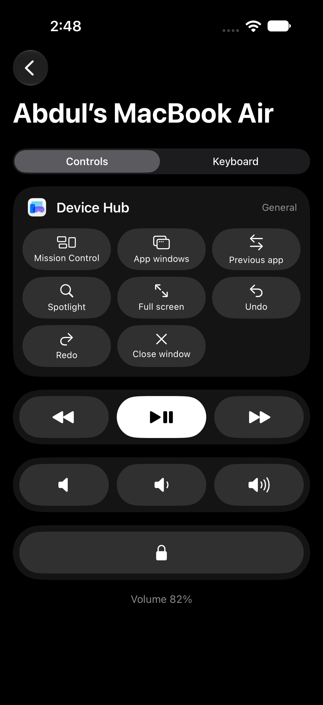
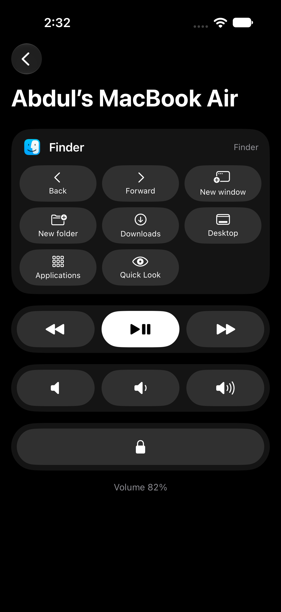
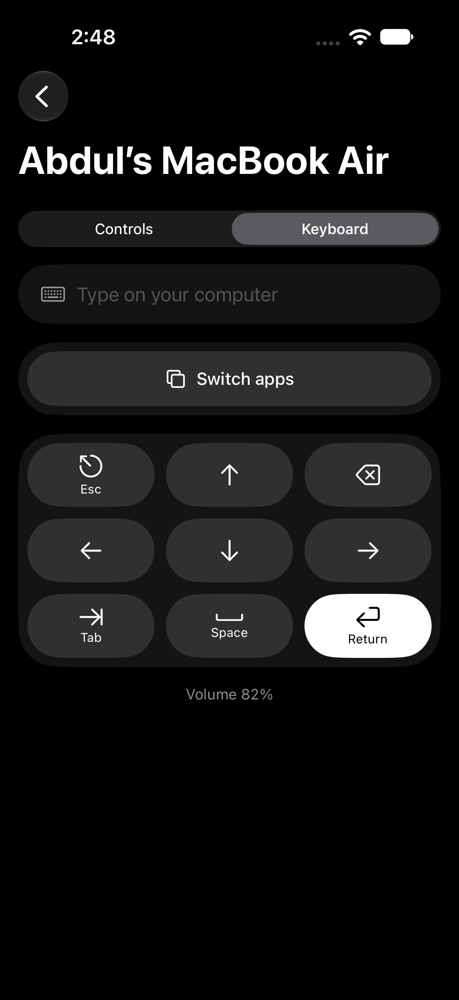

# Wand

**Your Mac, in your pocket.** Wand turns your iPhone into a smart remote for your Mac. Pause the music, change the
volume, and tap shortcuts for whatever app you're using, from across the room.

<p align="center">
  
  &nbsp;
  
  &nbsp;
  
</p>

## Features

- **Media and volume**: play/pause, next and previous track, volume up and down, mute, with the live level shown on the phone.
- **Shortcuts for the app in front**: Wand watches which app you're using and shows its shortcuts, updating the moment
  you switch. It ships with sets for browsers (Chrome, Safari, Arc, Dia, Firefox, Brave, Edge, Opera, Vivaldi), Figma,
  VS Code, Cursor, Windsurf, Zed, Xcode, terminals (Terminal, iTerm, Ghostty, Warp), Slack, Zoom, Teams, Finder, Mail,
  Notion, Notes, Keynote, PowerPoint and Spotify. Every other app gets a general set.
- **Remote keyboard**: type on your Mac from your phone in any language, emoji included. It also has arrow keys, Return, Esc, Tab and Delete.
- **App switcher**: open the ⌘Tab switcher, pick an app with ← →, and choose it.
- **Lock screen** from across the room.
- **Pair with a QR code**: scan the code on your Mac with the iPhone camera and you're done.
- **Private by design**: the phone talks directly to your Mac over your local Wi-Fi. There's no account and no cloud.

Coming next: one-tap screenshots to your clipboard, a trackpad mode, now-playing info with artwork, and Windows support.
See [docs/roadmap.md](docs/roadmap.md).

## How it works

```
iPhone app (SwiftUI)  ── finds your Mac with Bonjour ──▶  Wand for Mac (menu bar)
        │                                                        │
        └──── WebSocket + JSON over your local Wi-Fi ────────────┘
                                                                 ▼
                                   media keys, volume, key presses, app switcher
```

- **Wand for Mac** is a menu-bar app. It advertises itself on your network as `_wand._tcp` and presses keys for you,
  which is why it needs the Accessibility permission.
- **Wand for iPhone** finds it, pairs once with a 6-digit code or QR, then remembers the Mac.
- The wire protocol is plain JSON and documented in [docs/protocol.md](docs/protocol.md), so other clients and agents,
  such as the planned Windows app, can implement it.

More detail is in [docs/architecture.md](docs/architecture.md).

## Build it yourself

You need a Mac with **Xcode** (the iPhone app targets iOS 17+, and the Mac app macOS 14+) and [XcodeGen](https://github.com/yonaskolb/XcodeGen).

```sh
git clone https://github.com/itzareous/wand.git && cd wand
brew install xcodegen

# Signing: set your own Apple team and bundle-id prefix (a free personal team works)
cp Config/Local.xcconfig.example Config/Local.xcconfig
open -e Config/Local.xcconfig

xcodegen generate
open Wand.xcodeproj
```

1. Run the **WandMac** scheme. The setup window walks you through the Accessibility permission and shows a pairing QR code.
   Move the built app to `/Applications` so macOS remembers the permission between builds.
2. Run the **Wand** scheme on your iPhone (same Wi-Fi), then scan the QR code or tap your Mac and enter the code.

Run the protocol tests with `cd packages/RemoteKit && swift test`.

To test the Mac app without a phone, use the command-line client:

```sh
cd tools/remote-cli
swift run remote-cli pair 123456      # code from the Wand window
swift run remote-cli context          # app in front + its shortcuts
swift run remote-cli volume.up
```

## Project layout

| Path | What |
|---|---|
| `apps/ios` | iPhone app (SwiftUI) |
| `apps/mac-agent` | Mac menu-bar app (SwiftUI, Network.framework) |
| `apps/web` | Landing page (static HTML/CSS) |
| `apps/windows-agent` | Windows app (planned) |
| `packages/RemoteKit` | Shared protocol types (Swift package) |
| `tools/remote-cli` | Command-line client for testing |
| `docs/` | Architecture, protocol, roadmap, screenshots |
| `project.yml` | XcodeGen spec for both Apple apps |

## Contributing

Contributions are welcome. Adding shortcuts for an app you use is the easiest place to start. See
[CONTRIBUTING.md](CONTRIBUTING.md).

## License

[MIT](LICENSE)
